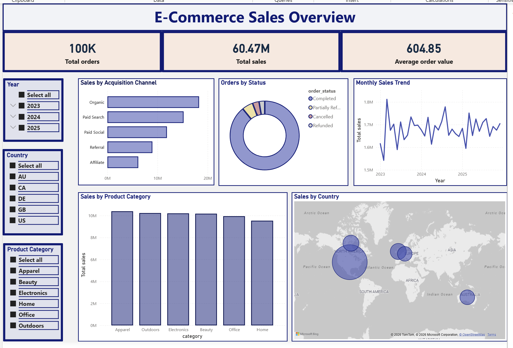
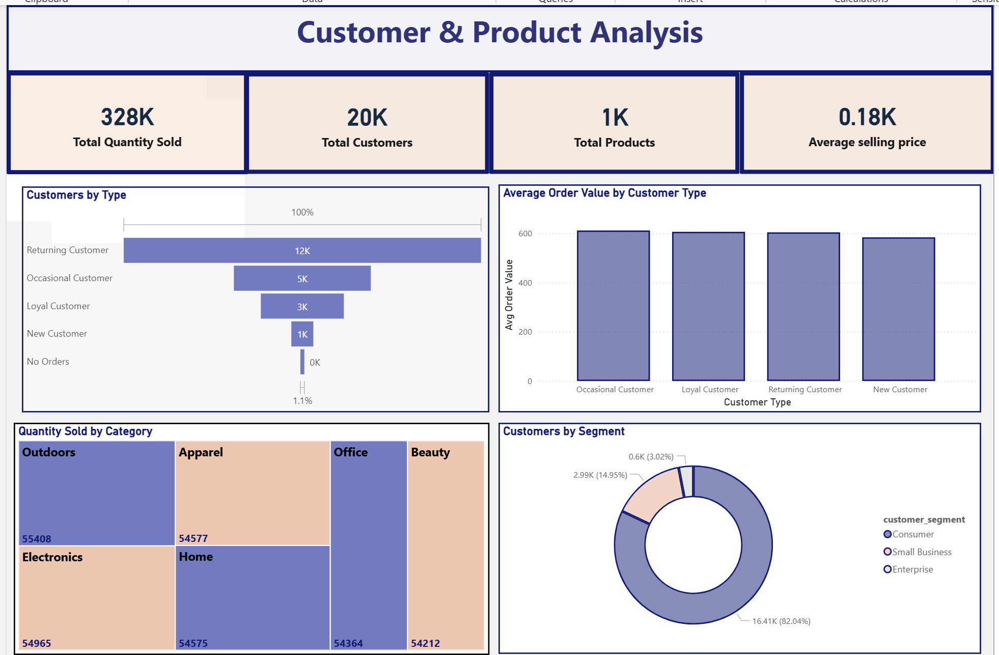
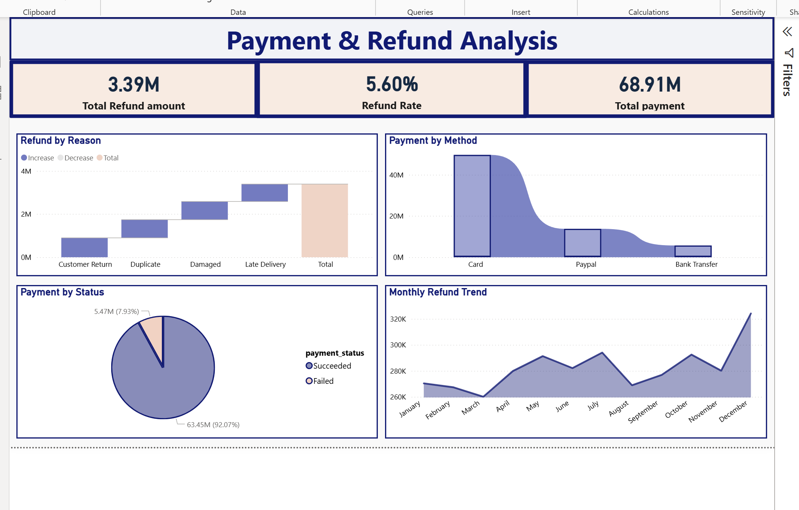

# E-Commerce Sales & Returns Analysis | Power BI

## Project Overview

This project analyzes e-commerce sales performance, customer purchasing behavior, product performance, payment methods, and product returns using Microsoft Power BI.

The objective is to transform raw e-commerce data into meaningful business insights through data cleaning, data transformation, data modeling, DAX calculations, and interactive dashboards.

The dataset covers January 2023 to January 2026. Since 2026 contains only January data, the analysis focuses on the complete years **2023–2025** for consistent year-over-year comparisons.

## Business Objectives

- Analyze overall sales performance and order trends.
- Identify top-performing product categories.
- Understand customer purchasing behavior and purchasing frequency.
- Analyze customer distribution by country and acquisition channel.
- Evaluate payment methods and payment statuses.
- Monitor refund amounts, refund reasons, and refund trends.
- Build interactive dashboards to support data-driven business decisions.

## Dataset Information

- **Domain:** E-Commerce Analytics
- **Time Period:** January 2023 – January 2026
- **Analysis Period:** 2023–2025
- **Number of Tables:** 6

### Tables Used

| Table | Description |
|---|---|
| Customers | Customer information, country, segment, and acquisition channel |
| Products | Product details, categories, costs, and prices |
| Orders | Order details, dates, statuses, and total amounts |
| Order Items | Product quantities, discounts, and line totals |
| Payments | Payment methods, statuses, and payment amounts |
| Refunds | Refund dates, reasons, and refund amounts |

## Tools & Technologies

- **Microsoft Power BI:** Dashboard development and data visualization.
- **Power Query:** Data cleaning, preprocessing, and transformation.
- **DAX:** Measures, calculations, and customer classification.

## Data Cleaning & Transformation

The following data preparation activities were performed:

- Verified and corrected column data types.
- Checked duplicate records using unique identifiers.
- Applied Trim and Clean transformations to text columns.
- Checked blank values and data quality.
- Converted date columns into appropriate date and datetime formats.
- Validated numerical columns for consistency.
- Checked column quality to identify valid, empty, and error values.
- Verified relationships between the six datasets.
- Configured relationship cardinality and filter direction in Power BI.

## Data Modeling

Established relationships between the following six tables:

- Customers
- Products
- Orders
- Order Items
- Payments
- Refunds

Configured relationship cardinality and filter direction to support accurate and interactive analysis.

## DAX Measures & Calculations

Created DAX measures to evaluate sales, orders, customers, products, payments, discounts, and refunds.

### Sales & Order Measures
- Total Sales
- Total Orders
- Average Order Value
- Total Quantity Sold
- Average Selling Price
- Total Discounts

### Customer & Product Measures
- Total Customers
- Total Products

### Payment & Refund Measures
- Total Payment Amount
- Total Refund Amount
- Total Refunds
- Refund Rate

### Customer Classification

Created a calculated column named `Customer Type` to classify customers based on order frequency.

| Customer Type | Order Count |
|---|---:|
| No Orders | 0 |
| New Customer | 1 |
| Occasional Customer | 2–3 |
| Returning Customer | 4–7 |
| Loyal Customer | 8 or more |

## Power BI Dashboard Pages

The Power BI report contains three interactive dashboard pages.

### 1. E-Commerce Sales Overview

**KPIs:**
- Total Sales
- Total Orders
- Average Order Value

**Visualizations:**
- Monthly Sales Trend
- Sales by Product Category
- Sales by Country
- Orders by Status
- Sales by Acquisition Channel

### 2. Customer & Product Analysis

**KPIs:**
- Total Customers
- Total Products
- Total Quantity Sold
- Average Selling Price

**Visualizations:**
- Customers by Segment
- Product Category Quantity Analysis
- Purchase Frequency Analysis
- Average Order Value by Customer Type

### 3. Payments & Returns Analysis

**KPIs:**
- Total Payment Amount
- Total Refund Amount
- Total Refunds

**Visualizations:**
- Payment Amount by Payment Method
- Refund Amount by Refund Reason
- Monthly Refund Trend
- Payment Status Analysis

### Interactive Features

- Year slicer
- Country slicer
- Product Category slicer
- Synchronized slicers across all three dashboard pages

## Key Business Insights

### Sales Performance
- Total sales reached approximately **60.48 million**.
- Organic acquisition generated the highest sales at approximately **18.29 million**.
- The United States contributed approximately **38.53 million** in sales.
- Apparel recorded the highest category sales at approximately **10.39 million**.

### Customer Analysis
- Returning Customers formed the largest customer group, with **11,846 customers**.
- Occasional Customers recorded the highest average order value of **611.13**.

### Product Analysis
- Outdoors recorded the highest quantity sold.
- Sales values were relatively close across all six product categories.

### Payment Analysis
- Card payments contributed the highest payment amount at approximately **49.70 million**.
- Successful payments accounted for approximately **63.45 million**.
- Failed payments accounted for approximately **5.47 million**.

### Refund Analysis
- Customer Returns recorded the highest refund amount at approximately **884.58K**.
- December recorded the highest monthly refund amount at approximately **324.19K**.

## Business Recommendations

- **Improve Customer Retention:** Introduce loyalty programs and personalized offers to encourage repeat purchases.
- **Optimize Acquisition Channels:** Evaluate Organic and Paid Search performance to improve marketing strategies.
- **Review Refund Reasons:** Investigate Customer Return and Duplicate refunds to identify possible operational improvements.
- **Reduce Payment Failures:** Investigate failed payment patterns and identify opportunities to improve payment success rates.

## Conclusion

This project demonstrates the practical application of Power BI for analyzing e-commerce business performance.

Through data cleaning, transformation, data modeling, and DAX calculations, raw data was converted into meaningful business insights.

The three interactive dashboard pages provide an integrated view of sales performance, customer behavior, product trends, payment activities, and refunds.

Overall, the project demonstrates how data analytics can support business understanding, identify performance patterns, and enable data-driven decision-making.

---

**Project Domain:** E-Commerce Analytics  
**Tools:** Microsoft Power BI | Power Query | DAX  
**Analysis Type:** Descriptive, Diagnostic & Prescriptive Analytics
## Dashboard Screenshots

### 1. E-Commerce Sales Overview

### 2. Customer & Product Analysis

### 3. Payments & Returns Analysis

